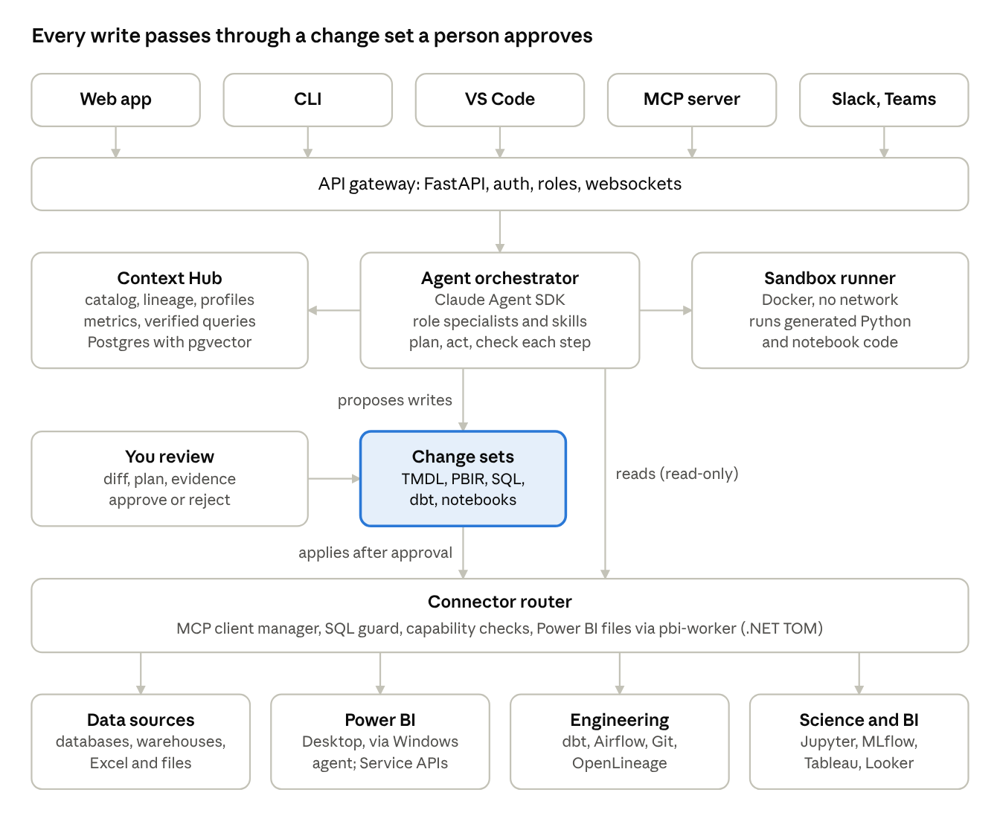

# Data Workbench Product Build Plan

Oct 25, 2026 · @Sai Sankar

> **Revised 26 Oct 2026** after the review in `docs/REVIEW.md`. The decisions are **Power BI first** and **local-first** (ADR 0001); the runtime and model are in ADR 0002, and the local stack in ADR 0003. Sections marked *(revised)* changed. The original plan is `docs/source/Data_Workbench_Product_Build_Plan.docx`.

## Product summary

We build **Datawright** (working name), an AI workbench that sits on top of the tools data teams already use and turns their most repetitive work into reviewable, one-click changes. It does not replace Power BI, dbt, Jupyter or the warehouse. It connects to them, understands the team's data, and proposes work as diffs a human approves.

**One-line pitch:** "Your data stack's teammate: it answers the routine questions, documents and fixes your models, explains broken pipelines and drafts the report, and every change waits for your approval."

#### Who it serves

- Data analysts and BI developers: governed question answering, Power BI model documentation and auditing, report page generation, weekly narratives.
- Data engineers: pipeline failure diagnosis, dbt model, test and doc generation, schema change impact.
- Data scientists: notebook EDA autopilot, data quality profiling, experiment summaries.

#### Five principles that come from the research

1. Connect, don't replace. Reuse official MCP servers where they exist (Power BI, dbt, Tableau, databases) and only build adapters for the gaps.
2. Everything is a reviewable diff. Writes go through a change set (TMDL, PBIR, SQL, dbt YAML, notebook cells) that a human approves.
3. Context first. A shared context hub of schemas, metrics, lineage, docs and verified queries grounds every agent call; benchmarks show context matters more than model size.
4. Small verified steps. Agents plan, act in short steps and check each one, because multi-step reliability is the known weak point.
5. Read-only by default. Write access is opt-in per connection.

**Scope of this plan** *(revised)*: the full product is still the long-term goal, but it is built **Power BI first**. Phase A validates with real users before any platform code. Phases 0 to 2 are the MVP: a local Power BI model doctor (audit, document, make AI-ready), then the DAX helper, Ask over semantic models, and Narratives. SQL sources, team features and governance follow in Phase 3. Every other module waits for paying customers to ask for it. The plan is written so Claude Code can build it phase by phase from the instructions in the last section.

**Where it fits against existing tools:** Databricks Genie and Snowflake Cortex Analyst lead question answering inside their own platforms, and Hex's Notebook Agent serves analysts in notebooks ([Rework, Aug 2026](https://resources.rework.com/tools/ai-agents/best-ai-agents-for-data-analysis-2026)); Power BI Copilot needs paid Fabric or Premium capacity. Datawright's opening *(revised)*: start where the gap is sharpest. Teams on Power BI Pro or PPU get no Copilot at all (it needs F2+ or P1+ capacity), and Fabric teams still have to prepare models by hand before Copilot answers well. Datawright makes models correct, documented and AI-ready, with every change reviewed. The cross-tool layer (one context hub and one review workflow across Power BI, SQL, dbt and notebooks) grows from there. The substitute to beat is a skilled user running Claude Code with the free Power BI Modeling MCP server, so the product must offer what one chat session can't: shared verified context, review and rollback for people who don't use Git, rule-based audits with history, eval-proven quality, and a no-code path.

## Business *(added)*

- **First customers:** Power BI freelancers and consultancies (many client models, buy fast, no enterprise security review), then SMB data teams on Pro licences. Enterprise (SSO, Helm) comes last.
- **Acquisition:** a free Model Health Check. Drop in a `.pbix` or PBIP and get a score and the top issues, with no signup and metadata only.
- **Pricing:** to be tested with design partners in Phase A. Hypothesis: free health check, a paid per-developer seat, and a consultant plan priced per client model.
- **Go/no-go gates:** week 2, three design partners committed; week 9, pilots return on their own and acceptance rate is measured and rising; week 14, at least one paying customer. If a gate fails, stop adding features (or change the wedge). Don't build the next phase on hope.

## Users and jobs

Each role gets a small set of jobs the product must do well, tied to the time sinks in the earlier research doc. The success measure is time saved on that job with an accepted output, not chat volume.

| **Role** | **Job to be done** | **Pain it removes** | **Module** | **Success measure** |
|---|---|---|---|---|
| Analyst | Answer a business question from governed data, showing the SQL or DAX | Ad hoc requests (a third to half of analyst time) | Ask | Answer accepted without rework |
| Analyst | Clean and prep a messy file or table with a reusable script | 6+ hours a week of cleansing | Prep & Quality | Script runs and passes checks |
| Analyst / BI dev | Document and audit a Power BI model in minutes | Slow model work; undescribed models break Copilot and agents | Power BI Studio | Findings fixed, descriptions accepted |
| Analyst / BI dev | Generate a report page from a request on an existing model | Repetitive report building | Power BI Studio | Page opens in Desktop, approved |
| Analyst / manager | Get "what changed and why" commentary for a dashboard | Tedious storytelling and slides | Narratives | Narrative sent with few edits |
| BI admin | Find unused, duplicate and orphaned Power BI content | Report sprawl | Power BI Studio (governance) | Items retired or merged |
| Data engineer | Know why a pipeline broke and get a proposed fix | ~13 hours per data incident | Pipeline Copilot | Time to diagnosis |
| Data engineer | Generate dbt models, tests and docs from a spec | Repetitive pipeline work | Pipeline Copilot | PR merged, tests pass |
| Data engineer | See downstream impact of a schema change before deploying | Breakages discovered by stakeholders | Pipeline Copilot | Impacted assets listed correctly |
| Data scientist | Get a first-pass EDA and data quality report in a notebook | Wrangling and notebook setup | Notebook Copilot | Notebook runs end to end |
| Data scientist | Summarise experiments and compare runs | Writing up results | Notebook Copilot | Summary accepted |
| Whole team | Take in, deduplicate and route requests | Vague, repeated requests | Request Desk | Share of requests auto-answered |

**Personas to design for** (from the Kandel interview study): "application users" who live in Excel and BI tools and never write code, "scripters" who work in SQL or Python, and "hackers" who chain many tools. The web app must serve the first group with no code required; the CLI, VS Code extension and MCP server serve the other two.

## Tool coverage

The product covers the core tools in every layer of the data stack, and for most of them an official or mature MCP server already exists. We wrap those behind one connector interface and build our own adapters only where nothing fits (Power BI report pages, Power BI admin governance, Excel, request intake).

Why these tools: Power BI leads BI adoption at roughly 20% market share, followed by Tableau and Qlik ([Coefficient, citing Gartner 2026](https://coefficient.io/data-analytics/bi-tools)); PostgreSQL is the most used database among developers in the 2025 Stack Overflow survey ([Stack Overflow 2025](https://survey.stackoverflow.co/2025/technology/)); Airflow remains the most used open-source orchestrator ([Atlan](https://atlan.com/know/ai-agent/data-for-ai/airflow-openlineage-for-ai/)). In India, Looker Studio dominates web-detected BI usage ([wmtips](https://www.wmtips.com/technologies/bi/country/in)), which matters if early customers are local.

| **Layer** | **Tool** | **Main users** | **How we integrate** | **Phase** *(revised)* |
|---|---|---|---|---|
| BI | Power BI PBIP / TMDL folders in Git | Analyst, BI dev | Own reader and targeted text editor (built in Phase 0) | 0-1 |
| BI | Power BI `.pbix` files (read-only) | Analyst, BI dev | `pbixray` (metadata only; table data never read) | 1 |
| BI | Power BI Desktop and Fabric models (live) | Analyst, BI dev | [Power BI Modeling MCP](https://github.com/microsoft/powerbi-modeling-mcp) (local, Windows) | 2 |
| BI | Power BI report pages (PBIR) | Analyst, BI dev | Own adapter: template-based PBIR generator and validator | 2 |
| BI | Power BI query from existing models | Analyst | Modeling MCP / [Remote Power BI MCP](https://learn.microsoft.com/en-us/power-bi/developer/mcp/mcp-servers-overview) | 2 |
| BI | Power BI Service, admin and usage | BI admin | Own adapter: Power BI REST and Admin APIs | 3 |
| Docs out | Markdown, PDF | Analyst, manager | Own renderers | 1-2 |
| Code | Git (local), then GitHub / GitLab PRs | All | Git CLI plumbing (Phase 0); GitHub API for PRs (Phase 3) | 0, 3 |
| Databases | PostgreSQL, MySQL, SQL Server | Analyst, Engineer | [MCP Toolbox for Databases](https://llmbase.ai/mcp-servers/mcp-toolbox-for-databases/) plus own read-only SQL guard | 3 (Postgres first) |
| Warehouses | Snowflake, BigQuery, Databricks SQL, Redshift, DuckDB | All | MCP Toolbox or native Python drivers | 3 (the one pilots use) |
| Files | Excel, CSV, Parquet | All | Own adapter: openpyxl, DuckDB, polars | 4+ (Excel Bridge) |
| BI | Tableau Cloud and Server | Analyst | [Official Tableau MCP](https://glama.ai/mcp/servers/@tableau/tableau-mcp) | 4+ on demand |
| BI | Looker, Looker Studio | Analyst | MCP Toolbox (Looker) | 4+ on demand |
| Transform | dbt Core and dbt Platform | Engineer, analytics engineer | [dbt MCP server](https://pypi.org/project/dbt-mcp) (overlaps dbt Labs' own agents) | 4+ on demand |
| Orchestration | Apache Airflow 2 and 3 | Engineer | Community [airflow-mcp-server](https://skillselion.com/mcp/tool/io.github.abhishekbhakat/airflow-mcp-server) in safe mode, or own thin REST client | 4+ on demand |
| Lineage | OpenLineage, Marquez | Engineer | Own consumer of OpenLineage events | 4+ on demand |
| Quality | dbt tests, Great Expectations, Soda | Engineer, Analyst | Generate tests as code; read results | 4+ on demand |
| Notebooks | Jupyter, JupyterLab, VS Code notebooks | Scientist | [jupyter-mcp-server](https://i-programmer.info/news/90-tools/18875-jupyter-notebooks-mcp-server-.html) (Datalayer) | 4+ on demand |
| ML tracking | MLflow | Scientist | Own adapter: MLflow REST API | 4+ on demand |
| Compute | Spark, Databricks jobs | Engineer, Scientist | Databricks REST API | 4+ on demand |
| Work intake | Slack, Microsoft Teams, Jira | All | Own adapters (webhooks and bots) | 4+ on demand |
| Docs out | PowerPoint | Manager | python-pptx | 4+ on demand |

#### Connector rules

- Every connector declares its capabilities as read, propose or apply, and the platform enforces them.
- A third-party MCP server runs as a pinned version in its own process or container; check each one's licence before bundling it.
- *(revised)* The MVP runs locally on the user's Windows machine, next to Power BI Desktop, with the PBIP files on disk. Only model metadata goes to the model provider, never table data. The cloud version (Phase 3) adds shared workspaces; it runs on Linux, and a desktop agent relays to it from Windows.
## Product modules

Nine modules share one platform. Each is specified below by what it takes in, what it produces, and the acceptance criteria Claude Code must meet before the module counts as done.

### M1. Context Hub (Phase 3; per-connection catalog since Phase 0)

The shared memory every agent reads before acting.

- Inputs: connections (databases, warehouses, Power BI, dbt, Airflow, files); uploaded docs and glossaries.
- Does: crawls metadata on a schedule (schemas, tables, columns, types, row counts, sample-based profiles, Power BI tables and measures, dbt models and metrics, Airflow DAGs); stores assets and lineage edges; embeds descriptions for semantic search; stores verified queries (question plus approved SQL or DAX).
- Outputs: a searchable catalog in the web app; a search_context tool for agents; lineage view.
- Acceptance: crawls a 200-table Postgres sample and a sample PBIP model in under 5 minutes; search returns the right table in the top 3 for 90% of a 50-question test set; secrets never appear in stored metadata.
### M2. Ask: governed question answering (Phase 2 over semantic models in DAX; SQL in Phase 3)

- Inputs: a natural-language question, the chosen data source or semantic model.
- Does: retrieves context and similar verified queries; asks a clarifying question when the question is ambiguous; generates SQL (via sqlglot-checked dialects) or DAX; runs it read-only with a row limit and cost check; returns the answer, the query, a chart and the assumptions made.
- Outputs: answer card; "save as verified query" button; "promote to dashboard" action.
- Acceptance: blocks any non-SELECT statement on read-only connections; shows the executed query every time; reaches an agreed execution-accuracy target on the internal eval set (see Testing); answers in under 30 seconds for simple questions.
### M3. Power BI Studio (Phases 1-3; the MVP core)

Five tools in one module. Auditor and documenter come in Phase 1; DAX helper and report pages in Phase 2; governance scan in Phase 3. *(revised)* Shared rules:

- **Intake:** PBIP/TMDL folders in Git (read and write), and `.pbix` files (read-only, metadata only, via `pbixray`), with a guided "Save as PBIP + start tracking with Git" step for write-back.
- **Audit rules:** port Microsoft's Best Practice Analyzer rule list (check its licence) plus our own. Rules find problems; the LLM explains and fixes them.
- **AI-ready pack:** descriptions and synonyms, plus AI instructions and suggested verified answers for Copilot's *Prep data for AI*. Check how PBIP stores these before promising them.
- **Report pages:** generated only from a small library of tested visual templates (card, bar, line, table, matrix, slicer). The LLM picks the template, fields and layout; it never writes raw visual JSON.
- **TMDL writes:** targeted text edits that keep every other byte (Phase 0). Use the Modeling MCP or TOM only if edits outgrow that; don't build both.

1. Model auditor: reads the model via TMDL, runs best-practice rules (relationships, unused columns, missing descriptions, DAX anti-patterns, data types, row-level security gaps) and returns findings with severity and a proposed fix.
2. Model documenter: drafts descriptions, synonyms and display folders for tables, columns and measures from context; produces a TMDL change set and a human-readable model guide.
3. DAX helper: writes, explains and optimises measures using model context; validates by running the measure through the Modeling MCP before proposing it.
4. Report page builder: turns a request ("sales by region with a monthly trend and top 10 products") into PBIR page and visual JSON against an existing model; validates against PBIR JSON schemas.
5. Tenant governance scan: uses the Admin and REST APIs to list unused reports, orphaned semantic models (zero dependents), duplicate measures and stale refreshes.
- Acceptance: round-trips TMDL with no unintended changes (golden-file tests); generated pages open in Power BI Desktop without errors; every write is a change set applied to a PBIP folder in Git; governance scan runs read-only.
### M4. Prep & Quality (Phase 4+, on demand)

- Does: statistical profiling first (nulls, distinct counts, distributions, outliers, drift against previous runs), then the LLM proposes a cleaning plan as code (Python with polars, or SQL) rather than editing data; generates data tests (dbt tests or Great Expectations suites).
- Acceptance: the generated script is deterministic and re-runnable; every cleaning step is listed in plain language; distribution-level issues come from statistics, not the LLM alone.
### M5. Pipeline Copilot (Phase 4+, on demand)

- Does: on a failed Airflow task or dbt run, pulls logs, recent code and schema changes, and lineage; produces a diagnosis with evidence and a proposed fix as a PR; generates dbt models, tests and docs from a spec; runs impact analysis for a proposed schema change using lineage plus SQL parsing.
- Acceptance: diagnosis cites the exact log lines and changes it relied on; impact analysis lists every downstream dbt model and Power BI table that reads the changed column in the test fixture.
### M6. Notebook Copilot (Phase 4+, on demand)

- Does: inside Jupyter (via MCP), builds an EDA notebook cell by cell, runs each cell, reads outputs and fixes errors; summarises MLflow experiments; checks notebooks for reproducibility (hidden state, out-of-order execution, unpinned packages).
- Acceptance: the produced notebook runs top to bottom on a fresh kernel.
### M7. Narratives (Phase 2: weekly "what changed" from a Power BI model, Markdown/PDF/email)

- Does: compares the latest period with the previous one on a chosen dashboard or metric set, finds the biggest movers and their drivers, writes commentary, and exports Markdown, PDF or PowerPoint.
- Acceptance: every number in the narrative is traceable to a stored query result.
### M8. Request Desk (Phase 4+, on demand)

- Does: takes requests from the web app, Slack, Teams or Jira; asks clarifying questions; matches them against verified queries and past answers; answers simple ones through Ask; routes the rest to a person with context attached.
- Acceptance: duplicate detection on a labelled set; no answer is auto-sent without a verified query or analyst approval unless an admin enables it.
### M9. Excel Bridge (Phase 4+; the candidate second wedge: Excel to Power BI migration)

- Does: reads workbooks (formulas, named ranges, pivot tables), explains the logic, and proposes an equivalent Power Query and DAX model or a SQL transformation; writes Excel outputs on request.
- Acceptance: converted logic reproduces the workbook's totals on test files.
## Architecture

All surfaces talk to one API; the agent orchestrator reads context and data freely through read-only connectors, but anything that changes a customer system becomes a change set that a person approves before the connector router applies it.



*system architecture · 6 layers, from surfaces to customer tools*

Reading top to bottom: people work in the web app, CLI, VS Code, Slack or Teams, or call Datawright from their own agent through its MCP server. The orchestrator pulls grounding from the Context Hub, runs generated code in the sandbox, and reaches every tool through the connector router, which enforces capabilities and the SQL guard. Background jobs (Celery) run crawls and scans, and OpenTelemetry traces every step; they sit beside the API and are left off the picture for clarity.

*(revised)* The diagram is the long-term target. The MVP runs as one local Python process: a CLI, a local review web UI and (Phase 1) the Datawright MCP server, over SQLite. There is no sandbox until generated code needs to run, and no job queue until Phase 3.

## Tech stack and repository layout

*(revised; see ADR 0002 and 0003)* Python only for the MVP: one package, one local process. TypeScript, .NET and Docker come back only when a phase needs them.

| **Layer** | **Choice (MVP)** | **Why** | **Later** |
|---|---|---|---|
| Language | Python 3.11+ | The data ecosystem's language | — |
| API and UI | FastAPI + Jinja2 server-rendered pages, plain HTML forms, bound to 127.0.0.1 | One process, works offline, no JS build | Rich UI (lineage graph, Monaco diff) in Next.js when needed |
| Database | SQLite via SQLAlchemy 2 + Alembic | Local-first; no server to install | PostgreSQL + pgvector in the cloud version (Phase 3) |
| Background jobs | None (runs are short and user-triggered) | Fewer moving parts | Job queue in Phase 3 for scheduled crawls and narratives |
| Agent runtime | Messages API (`anthropic` SDK) with our own tool loop | One place for step recording and permission checks; testable without a key | Agent SDK for the desktop agent (Phase 2); Managed Agents for hosted runs (Phase 3+) |
| Models | `claude-sonnet-5-5` only, effort `medium`, server-side refusal fallback | Measure before routing; prompt caches are per model | `claude-haiku-4-5` / `claude-opus-5-5` only where measured cost per accepted task improves |
| MCP | Official `mcp` Python SDK (FastMCP) for the Datawright MCP server (Phase 1) | Users already work in Claude Desktop, Claude Code and VS Code | Client manager for third-party servers |
| Power BI | PBIP/TMDL in Git; own reader + targeted text edits; `pbixray` for `.pbix`; Modeling MCP for live Desktop (Phase 2) | Byte-exact diffs, no .NET dependency | TOM (.NET) worker only if text edits stop being enough |
| SQL | sqlglot guard | Parse, validate, block writes | Phase 3 |
| Sandbox | None yet | Nothing runs generated code before Phase 4 | Docker or Managed Agents sandbox |
| CLI | Typer | For scripters, CI and the demo | — |
| Auth | Single local user, role `admin`; CSRF + Host/Origin checks | Local-first | OIDC + roles in the cloud version |
| Observability | Every model call and tool call stored as an AgentStep with tokens and cost | Debugging agents needs full traces | OpenTelemetry export |
| Testing | pytest, golden files, scripted model client, FastAPI test client | Fast, no API key needed | Playwright for the richer UI |

#### Repository layout *(revised: as built in Phase 0)*

```
data ai/
  CLAUDE.md                       # instructions for Claude Code
  docs/  PLAN.md  REVIEW.md  adr/  specs/  source/  img/
  src/datawright/
    cli.py                        # datawright connect | crawl | audit | document | demo | serve | evals
    config.py  db.py  models.py   # settings, SQLite + Alembic, entities
    services.py                   # connect, crawl, audit
    core/                         # change sets, git plumbing, capabilities, audit log, object paths
    connectors/
      base.py  edits.py           # Connector interface; edit ops a change item can carry
      powerbi/                    # tmdl.py (reader/editor), pbip.py (repo connector), rules.py
    agents/                       # runtime (tool loop), tools registry, documenter, scripted client
      skills/powerbi/             # Markdown playbooks
    evals/harness.py              # eval runner
    web/                          # local review UI (FastAPI + Jinja2)
    migrations/                   # Alembic
  evals/  datasets/  thresholds.yaml
  fixtures/pbip/                  # retail-clean, retail-issues
  tests/  golden/
  .github/workflows/ci.yml
```

## Core data model and agent design

The change set is the heart of the product: agents never write directly to a customer system; they produce a change set, a human approves it, and only then does the platform apply it.

### Core entities (SQLite in the MVP, PostgreSQL in the cloud version; Phase 0 built the subset in docs/specs/core.md)

| **Entity** | **Key fields** | **Notes** |
|---|---|---|
| Organization, User, Membership | role: viewer, analyst, developer, admin | Role decides who can approve and apply |
| Connection | type, config, secret_ref, capabilities (read, propose, apply), status | Secrets stored encrypted, referenced by id |
| Asset | kind (table, column, view, semantic_model, measure, report, page, dbt_model, dag, task, notebook, experiment), name, path, description, profile JSON, embedding, connection_id | One table for every catalog object |
| LineageEdge | from_asset, to_asset, kind (reads, writes, derives), source (sqlglot, openlineage, dbt, pbi) | Column-level where available |
| MetricDefinition | name, expression, grain, owner, source asset | Mirrors dbt or Power BI measures |
| VerifiedQuery | question, query_text, dialect, asset ids, approved_by, use_count | Reused by Ask and Request Desk |
| AgentRun | module, user, prompt, plan, status, model, tokens, cost, trace_id | One per task |
| AgentStep | run_id, kind (think, tool_call, check), tool, input, output summary, duration | Full audit trail |
| ChangeSet | run_id, target connection, status (draft, proposed, approved, applied, rejected, rolled_back), git branch or PR url | The only path to writes |
| ChangeItem | change_set_id, file or object path, before, after, diff | TMDL, PBIR, SQL, YAML, ipynb |
| Finding | source (audit, quality, governance), asset_id, rule, severity, message, proposed_change_item | From auditor, profiler, scans |
| Request | channel, requester, text, status, matched_verified_query, assignee | Request Desk |
| Schedule | job type, cron, target | Crawls, scans, narratives |
| EvalCase, EvalResult | dataset, input, expected, score, model, commit sha | Regression gating |
| AuditLog | actor, action, object, timestamp | Immutable |

### Agent design

- Orchestrator *(revised)*: not needed while there are only a few modules. The user picks the task (CLI, UI or MCP tool). Add a router only when the number of modules makes picking hard.
- Specialists: Analyst, BI Developer, Data Engineer, Data Scientist. Each has a system prompt, an allow-listed tool set, and skills: versioned Markdown playbooks such as powerbi/document-model.md, sql/answer-question.md, dbt/generate-tests.md, airflow/diagnose-failure.md.
- Loop per task: understand, gather context from the hub, show a short plan, act in small steps, run a check after each step (query executes, TMDL validates, notebook cell runs, tests pass), then produce the output and any change set.
- Tool registry: every tool has a name, JSON schema, capability level (read, propose, apply), timeout and cost class. Specialists only see tools at or below the run's permission level.
- Clarify before guessing: if the context search returns several plausible tables or metrics, the agent asks one multiple-choice question instead of picking.
- Memory: per-workspace verified queries, glossary and past accepted change sets feed future runs; nothing personal from one customer is shared with another.
### Approval flow

1. Agent creates a change set in draft and runs validations.
2. It moves to proposed; the web app shows the diff, the plan, the evidence and the validation results.
3. A user with the right role approves or rejects with a comment (rejections are saved as feedback for evals).
4. On approval the platform applies: for file-based targets it commits to a new `datawright/cs-<id>` branch built in a temporary index, so the user's working tree and current branch are never touched (a GitHub/GitLab PR comes in the cloud version). For API targets it executes against the connection. Then it records the result.
5. Every applied change set can be rolled back from its stored before-state.
## Build phases

*(revised)* Power BI first, with a validation gate before platform code. Week numbers assume the team works on it as needed. Exit criteria, not dates, decide when a phase ends: a phase is done only when every exit criterion passes.

| **Phase** | **Deliverables** | **Exit criteria** |
|---|---|---|
| A. Validate (weeks 0-2, no platform code) | 15 interviews with Power BI developers, analysts and consultants; a concierge test (audit and document 3 real models by hand with Claude Code + the Modeling MCP + BPA rules); a record of each person's setup (`.pbix` or PBIP, Pro or Fabric, Git or not) | 3 design partners committed to a pilot on real models; at least 2 say they'd pay at a named price; a one-page target-customer description |
| 0. Thin foundation (weeks 2-4) **✓ built 26 Oct 2026** | Python package, SQLite + Alembic, entities, change set service with Git-branch apply and rollback, TMDL reader/editor, Phase 0 audit rules, agent tool loop with permission-filtered tool registry and recorded steps, `document-measures` agent, local review UI, CLI, eval harness, PBIP fixtures, CI | `datawright demo` reads `retail-issues`, records findings, runs the documenter and leaves a proposed change set; in the UI it can be approved, applied as a commit on `datawright/cs-<id>` (working tree untouched) and rolled back; steps are visible; ruff, mypy and pytest pass; `audit-rules-v0` passes |
| 1. Power BI Model Doctor (weeks 4-9, first pilot release) | `.pbix` intake (`pbixray`); BPA rule port; documenter for tables, columns and measures + model guide (Markdown/PDF); AI-ready pack; Datawright MCP server (`audit_model`, `document_model`, `propose_fix`, `list_findings`); free Health Check page; guided "start tracking with Git"; PBI-Bench v0 (30-40 cases) | Fixtures (and pilot models) open in Power BI Desktop after apply; TMDL golden tests pass; all 3 pilots use it on their own models at least twice in two weeks; description acceptance rate measured (start target: 60% accepted without edits, agreed with pilots) |
| 2. DAX, Ask, Narratives (weeks 9-14, first paid version) | Windows desktop agent + Modeling MCP for live DAX validation; DAX helper; Ask over semantic models (question to DAX, query always shown, verified queries); Narratives v1 (weekly "what changed", Markdown/PDF/email); template-based PBIR page builder; billing | PBI-Bench ~100 cases baseline; generated pages open in Desktop without errors across the test set; at least one paying customer |
| 3. Team, governance and SQL (weeks 14-20) | Cloud workspace (Postgres, OIDC, roles, approval by a second person, shared Context Hub with verified queries and glossary); job queue; GitHub/GitLab PRs; tenant governance scan (Admin APIs, read-only); Postgres + one warehouse crawler, SQL guard, Ask on SQL | M1 and M2 acceptance criteria pass; one team of at least 3 people works in a shared workspace |
| 4+. On demand | Choose from: Excel Bridge, Pipeline Copilot, Prep & Quality, Notebook Copilot, Request Desk, Tableau/Looker, enterprise (SAML, Helm, admin console) | Build a module only when at least 3 paying customers ask for it |

## Testing and evaluation

Agent quality is measured on fixed eval sets on every merge to main, and a drop beyond an agreed threshold blocks the merge. Conventional tests cover everything that is not the model.

#### Conventional tests

- Unit: domain logic, SQL guard (every DDL and DML form must be blocked on read-only), permission checks, diff generation.
- Golden files: TMDL load and save round-trips, PBIR generation, dbt YAML generation, compared byte for byte with fixtures.
- Connector integration: testcontainers for PostgreSQL, MySQL and SQL Server; DuckDB in-process; a local Airflow and Jupyter in Docker; recorded HTTP fixtures for Power BI, Tableau and MLflow APIs.
- End to end: Playwright runs through connect, ask, review a change set, approve, apply.

#### Fixtures *(revised)*

- Done in Phase 0: two PBIP semantic models, `retail-clean` and `retail-issues`, with planted problems (see `fixtures/README.md`). Hand-written; they must be opened in Power BI Desktop before Phase 1 exits.
- Phase 1: real `.pbix` files (with permission) from design partners, and Desktop-saved copies of the fixtures.
- Later, with the phases that need them: a retail Postgres database (Phase 3); a dbt project, an Airflow DAG and a notebook with planted problems (Phase 4+).

#### Agent eval sets

*(revised)* Build the internal Power BI sets first. Public benchmarks cost warehouse time and don't predict whether pilots accept the output, so they come later and mostly serve marketing.

| **Eval set** | **What it measures** | **Source** | **Scorer** |
|---|---|---|---|
| audit-rules-v0 *(built)* | Auditor finds exactly the planted problems | Fixtures | Exact set match (deterministic) |
| describe-v0 *(built)* | Proposed measure descriptions meet the floor | Fixtures | Present, at most 300 chars, no raw DAX, names the right thing; rubric grading in Phase 1 |
| SQL-Internal (≈150 cases) | Question to SQL on the fixture DB | Written by us | Execution match of result sets |
| [Spider 2.0-lite](https://mlanthology.org/iclr/2025/lei2025iclr-spider) subset | Enterprise text-to-SQL | Public benchmark | Official scorer |
| [DABstep](https://www.arxiv.org/abs/2506.23719) dev split | Multi-step analysis with docs | Public benchmark | Official exact-answer check |
| PBI-Bench (≈100 cases, ours) | DAX measures, descriptions, audit fixes, report pages | Written by us on fixture PBIPs | DAX executes and matches expected values; TMDL validates; PBIR schema-valid; rubric for descriptions |
| Diagnose-Bench (≈40 cases, ours) | Root cause of planted pipeline failures | Written by us | Correct cause named and cited |
| [ELT-Bench](https://arxiv.org/abs/2504.04808v1) subset | dbt and pipeline generation | Public benchmark | Official scorer |

**Product metrics tracked from launch:** change set acceptance rate, edits before acceptance, time from request to accepted answer, cost per accepted task, and share of answers served from verified queries. PBI-Bench could later be published as a public benchmark, since no end-to-end Power BI agent benchmark appeared in the research.

## Security, privacy and risks

Customer data is the product's biggest liability, so the defaults are read-only access, minimal data sent to the model, and a full audit trail.

#### Security and privacy rules (build these in Phase 0, not later)

- Least privilege: connections are read-only unless an admin enables propose or apply; the SQL guard parses every query with sqlglot and rejects writes, multi-statement payloads and system-table access on read-only connections.
- Data minimisation: agents see schemas, profiles and small samples; samples are capped (for example 20 rows) and columns tagged as PII are masked before any model call.
- Secrets: encrypted at rest, never logged, never placed in prompts; tools receive a connection id, not credentials.
- Untrusted content: text from data, docs, notebooks, logs and tickets is treated as data, never as instructions; tool output is wrapped and labelled before it reaches the model.
- Sandbox: generated code runs in a container with no network, a read-only mount of inputs and CPU, memory and time limits.
- Audit: every agent step, tool call, approval and apply is logged with user, time and trace id.
- Deployment options: cloud-hosted for small teams; self-hosted Docker or Kubernetes for enterprises that cannot send metadata outside their network.

#### Risks

| **Risk** | **Likelihood** | **Impact** | **Mitigation** |
|---|---|---|---|
| Wrong answers erode trust (analysts spend longer fixing than doing) | High | High | Show the query every time, clarify before guessing, prefer verified queries, measure acceptance rate |
| Platform vendors ship the same feature (Copilot, Genie, Cortex) | High | Medium | Stay cross-tool; focus on Power BI gaps (report pages, governance, Pro-licence teams) and on review workflow |
| Microsoft changes PBIR, TMDL or MCP formats | Medium | Medium | Pin versions, golden-file tests, isolate Power BI code in one package |
| Third-party MCP servers break or change licence | Medium | Medium | Connector interface allows swapping for our own thin API client |
| Model cost per task too high | Medium | Medium | Cache context, lower effort, cap turns per run, track cost per accepted task; route to a smaller model only where measured |
| Data leakage through prompts | Low | High | Minimisation, PII masking, self-hosted option, no training on customer data |
| Scope too big for a small team | High | High | *(revised)* Power BI only until paying customers ask for more; Phase A validation gate; go/no-go gates at weeks 2, 9 and 14 |
| Power BI testing needs Windows and licences | Medium | Medium | Use PBIP fixtures and TMDL validation on Linux; reserve a Windows machine for Desktop and Modeling MCP tests |
| *(added)* Users get the same result from Claude Code + the free Power BI Modeling MCP | High | High | Ship our own MCP server early, and win on what one chat session lacks: shared verified context, review and rollback for non-Git users, audit history, eval-proven quality |
| *(added)* dbt Labs and Microsoft ship agents inside their own tools | High | Medium | Stay out of dbt until customers ask; align with Microsoft (make models Copilot-ready) instead of competing |
| *(added)* Most users have `.pbix`, not PBIP in Git | High | Medium | Read `.pbix` metadata with `pbixray`; guided "Save as PBIP + start tracking with Git" for write-back |

## How to hand this to Claude Code

Give Claude Code this plan as docs/PLAN.md plus a short CLAUDE.md, then run one phase at a time with the prompts below, reviewing each phase's exit criteria before starting the next. Claude Code loads CLAUDE.md from the project root automatically at the start of every session ([Claude Code memory docs](https://code.claude.com/docs/en/memory?r=0)).

#### Setup steps *(revised)*

Phase 0 is set up: the repository is `Documents/Skyworks/data ai`, `CLAUDE.md` is in its root, and the plan is `docs/PLAN.md`. For each next phase:

1. Start Claude Code in the repository root and paste the phase prompt below. Ask it to plan first (plan mode), review the plan, then let it build.
2. After the phase: run tests and evals, check the exit criteria, commit, and tag (`v0.1-phase1` and so on).

**Per-phase prompts** (paste one at a time)

```
PHASE 1 - Power BI Model Doctor
Read docs/PLAN.md (M3, Build phases), docs/REVIEW.md section 5 and docs/specs/core.md.
Write docs/specs/powerbi.md first and show it to me. Then build: .pbix intake with
pbixray (metadata only); the BPA rule port (check licence) on the rules engine; the
documenter extended to tables and columns plus a Markdown/PDF model guide; the
AI-ready pack (only what PBIP can store); the Datawright MCP server (FastMCP) with
audit_model, document_model, propose_fix, list_findings; the free Health Check page;
the guided "start tracking with Git" step; PBI-Bench v0 (30-40 cases) with a
baseline. Stop at the Phase 1 exit criteria and show me the evidence.
```

```
PHASE 2 - DAX, Ask over semantic models, Narratives
Read docs/PLAN.md (M2, M3, M7, Build phases). Write docs/specs/dax-ask-narratives.md
first. Build the Windows desktop agent using the Power BI Modeling MCP; the DAX
helper that runs every measure before proposing it; Ask over the semantic model
(DAX, query always shown, verified queries); Narratives v1 with Markdown/PDF/email;
the template-based PBIR page builder; billing hooks. Grow PBI-Bench to ~100 cases.
Stop at the Phase 2 exit criteria.
```

```
PHASE 3 - Team, governance and SQL
Read docs/PLAN.md (M1, M2, M3 governance, Build phases). Write the specs first.
Build the cloud workspace (Postgres, OIDC, roles, approval by a second person),
the shared Context Hub, the job queue, GitHub/GitLab PRs, the read-only tenant
governance scan, Postgres + one warehouse crawler with the sqlglot SQL guard,
and Ask on SQL. Stop at the Phase 3 exit criteria.
```

## Sources

Tool and integration sources used for this plan; the user research and papers are in the earlier research doc, Data Roles & Automation Research.

- [Power BI Modeling MCP server (GitHub)](https://github.com/microsoft/powerbi-modeling-mcp)
- [Power BI MCP servers overview (Microsoft Learn)](https://learn.microsoft.com/en-us/power-bi/developer/mcp/mcp-servers-overview)
- [dbt MCP server (PyPI)](https://pypi.org/project/dbt-mcp) and [dbt MCP tool list](https://docs.getdbt.com/docs/dbt-ai/mcp-available-tools)
- [MCP Toolbox for Databases](https://llmbase.ai/mcp-servers/mcp-toolbox-for-databases/)
- [Tableau MCP (official)](https://glama.ai/mcp/servers/@tableau/tableau-mcp)
- [airflow-mcp-server](https://skillselion.com/mcp/tool/io.github.abhishekbhakat/airflow-mcp-server)
- [Jupyter MCP Server by Datalayer (I Programmer)](https://i-programmer.info/news/90-tools/18875-jupyter-notebooks-mcp-server-.html)
- [Airflow and OpenLineage (Atlan)](https://atlan.com/know/ai-agent/data-for-ai/airflow-openlineage-for-ai/)
- [Claude Agent SDK overview](https://platform.claude.com/docs/en/agent-sdk/overview) and [Python reference](https://code.claude.com/docs/en/agent-sdk/python.md)
- *(added)* [Copilot in Power BI capacity requirements](https://book.st-hakky.com/en/data-analysis/power-bi-copilot-features-f2-requirements-pricing); [Prep data for AI](https://learn.microsoft.com/power-bi/create-reports/copilot-prepare-data-ai-verified-answers); [dbt agents](https://docs.getdbt.com/docs/dbt-ai/dbt-agents); [pbixray](https://pypi.org/project/pbixray)
- [Claude Code memory and CLAUDE.md](https://code.claude.com/docs/en/memory?r=0)
- [Stack Overflow Developer Survey 2025](https://survey.stackoverflow.co/2025/technology/)
- [BI tools and market share (Coefficient)](https://coefficient.io/data-analytics/bi-tools); [BI usage in India (wmtips)](https://www.wmtips.com/technologies/bi/country/in)
- Competitor landscape: [Tellius comparison](https://www.tellius.com/resources/blog/best-ai-data-analysis-agents-in-2026-12-platforms-compared-for-nl-to-sql-autonomous-investigation-and-governance), [Rework comparison](https://resources.rework.com/tools/ai-agents/best-ai-agents-for-data-analysis-2026)
- Benchmarks: [Spider 2.0](https://mlanthology.org/iclr/2025/lei2025iclr-spider), [DABstep](https://www.arxiv.org/abs/2506.23719), [ELT-Bench](https://arxiv.org/abs/2504.04808v1)
